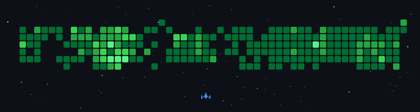

**What I do** 
Full-stack engineer who enjoys taking an idea all the way to production.

**How I pick tools** 
TypeScript is where I'm most at home, but I'm happy to pick up whatever the problem or the team calls for.

 

<picture>
  <source media="(prefers-color-scheme: dark)" srcset="https://raw.githubusercontent.com/franc1sjacob/franc1sjacob/cards/summary-dark.svg">
  
</picture>
<picture>
  <source media="(prefers-color-scheme: dark)" srcset="https://raw.githubusercontent.com/franc1sjacob/franc1sjacob/cards/languages-dark.svg">
  
</picture>

<picture>
  <source media="(prefers-color-scheme: dark)" srcset="https://raw.githubusercontent.com/franc1sjacob/franc1sjacob/cards/streaks-dark.svg">
  
</picture>
<picture>
  <source media="(prefers-color-scheme: dark)" srcset="https://raw.githubusercontent.com/franc1sjacob/franc1sjacob/cards/weekly-dark.svg">
  
</picture>

thanks for stopping by

